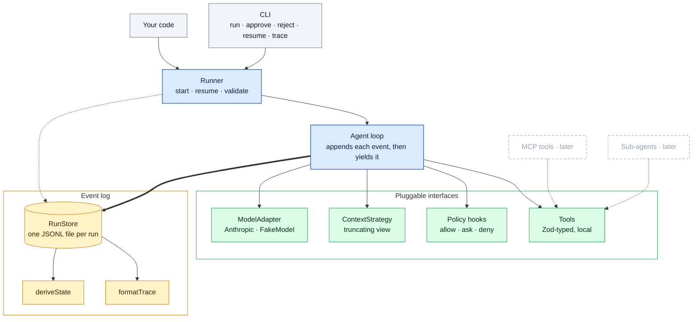

# Kern — Architecture

Oct 9, 2026 · @srk

## 1. Overview

Kern is a small TypeScript framework for building tool-using agents. Its central idea is simple: **each run is an append-only log of typed events, and the run state is derived from that log.** This gives one foundation for tracing, policy auditing and pausing/resuming runs, without separate state systems that can drift apart.

The architecture leaves room for MCP, sub-agents and stronger recovery semantics, but those are not planned for this build.

### Goals

- Define an agent and typed tools with a small TypeScript API.
- Complete an end-to-end run against one real model provider.
- Persist events as JSONL and make the trace easy to inspect.
- Pause before a tool that needs approval, then resume the same run.
- Keep the core provider-agnostic and leave clear extension points.

### Out of scope

- Sub-agents and MCP integration.
- Automatic retry of tool calls interrupted by a crash.
- Additional model adapters, advanced budget accounting and context compaction.
- Distributed execution, hosted UI, authentication and long-term memory.

These are scope choices for the build, not a rejection of the architectural decisions documented in the ADRs.

## 2. Core concepts

| Concept      | Meaning                                                                       |
| ------------ | ----------------------------------------------------------------------------- |
| Agent        | Configuration: name, model, instructions, tools, hooks and a step limit.      |
| Run          | One execution, identified by `runId`.                                         |
| Event        | An immutable, typed record of something that happened.                        |
| Event log    | The ordered run history, stored in `runs/<runId>.jsonl`.                      |
| Run state    | Derived from events with `deriveState(events)`.                               |
| Tool         | A function with a Zod input schema, an `execute` method and an approval flag. |
| Hook         | A policy seam that can allow, ask for approval or deny a tool call.           |
| Context view | The messages built from the log for the next model call.                      |

### Design principles

1. **The log is the source of truth.** State, traces and prompts are derived from events.
2. **The model drives a run; TypeScript drives workflows.** No graph DSL is needed in the kernel.
3. **Keep the core small.** Policy, storage and model integrations sit behind clear interfaces.
4. **The prompt is a view of history.** Truncating the prompt never changes the log.
5. **Normalize without losing provider data.** Internal message types keep raw provider blocks.
6. **Prefer standards over custom protocols.** MCP remains the planned tool interoperability layer.

## 3. Component architecture



The agent loop is the only component that writes events. The Runner reads the log to validate a resume, and hooks return decisions, but the loop records everything. Keeping a single writer makes event order easy to reason about and keeps the trace consistent with what the framework did.

## 4. Events and run state

Events form a TypeScript discriminated union, `KernEvent`. Each persisted event has a flat envelope `{ v, seq, runId, ts }` plus its type-specific fields. There are 11 event types:

`run_started`, `model_requested`, `model_responded`, `policy_decided`, `tool_started`, `tool_result`, `run_paused`, `approval_decided`, `run_resumed`, `run_completed`, `run_failed`.

The loop appends and flushes each event before exposing it to the caller or acting on it. This makes the log a complete record of what happened, but by itself it does **not** guarantee exactly-once execution of external side effects (see §5).

`deriveState(events)` is a pure function that returns the run status (`running`, `paused`, `completed` or `failed`), step count, any pending tool call, and the final output or error. JSONL storage survives a process crash but not a power loss, because appends are not fsync'd ([LIMITATIONS.md](LIMITATIONS.md)).

## 5. Run lifecycle

On every iteration, the loop decides its next action **from the log**, not from in-memory state:

1. If the run has ended, stop.
2. If the last model response has unanswered tool calls, process them in order:
   - an unknown tool or invalid input becomes an error result for the model to correct;
   - otherwise policy is applied, `tool_started` is recorded, the tool executes, and `tool_result` is recorded.
3. If the last model response has no tool calls, record `run_completed` with its text.
4. Otherwise, check the step limit (model calls per run, default 10), build the context view and call the model.

Because the next action always comes from the log, a fresh run, a resumed run and a run reloaded after a crash all go through the same code path. There is no separate recovery mode.

### Approval and resume

A call that needs approval records `run_paused`, and the stream ends. The process can exit. Later, `runner.resume()` (or the CLI's `approve` / `reject`) validates the request against the log. The loop then records `approval_decided` and `run_resumed` and continues the same run. An approved call runs; a rejected call is returned to the model as a tool error, so the agent can respond.

### Interrupted tool calls

A crash between steps resumes correctly, including a crash after an approval but before the tool runs. The uncertain case is a crash _during_ a tool call: `tool_started` is in the log, but `tool_result` is not, so the side effect may or may not have happened. Following ADR-003, Kern detects this case and fails the run for manual review instead of retrying. Automatic retry for tools declared idempotent is deferred.

## 6. Tools, policy and context

Tools use Zod schemas for input validation, and a tool can set `requiresApproval`. Policy hooks return `allow`, `ask` or `deny` for each validated call:

- All hooks run in order, and the strictest answer wins (deny > ask > allow).
- A hook that throws counts as `deny` (fail closed).
- `requiresApproval` upgrades any non-deny decision to `ask`.
- Every decision is recorded as `policy_decided` with its source.
- A denied call is returned to the model as a tool error.

Hooks can also observe each event after it is appended (`onEvent`). They never rewrite messages or tool arguments in v1, so the log stays a faithful record (ADR-006).

The default `ContextStrategy` builds the prompt from the log and truncates large tool outputs in the prompt only. The stored event keeps the full output. More advanced context compaction is deferred.

MCP tools and sub-agents fit behind the same tool interface, but are deferred from this build. Their design decisions are captured in ADR-005 and ADR-007.

## 7. Public API and stack

The main exports are `Agent`, `Runner`, `tool`, `Policy` types.

```ts
import { Agent, Runner, tool, Policy } from "kern";
import { z } from "zod";

const lookup = tool({
  name: "lookup",
  description: "Look up a sample record",
  input: z.object({ id: z.string() }),
  execute: async ({ id }) => ({ id, status: "found" }),
});

const updateStatus = tool({
  name: "update_status",
  description: "Change a sample record's status",
  input: z.object({ id: z.string(), status: z.string() }),
  execute: async ({ id, status }) => ({ id, status }),
});

const agent = new Agent({
  name: "demo-agent",
  model: "anthropic:<model-id>",
  instructions: "Use tools when needed, then summarize the result.",
  tools: [lookup, updateStatus],
  hooks: [Policy({ ask: ["update_*"] })],
});

const runner = new Runner();
const state = await runner.run(agent, "Close record A-17");

if (state.status === "paused") {
  await runner.resume(agent, state.runId, { decision: { approved: true } });
}
```

| Area          | Choice                                                 |
| ------------- | ------------------------------------------------------ |
| Runtime       | Node.js 22, ESM, TypeScript strict mode                |
| Input schemas | Zod v4                                                 |
| Model         | Anthropic adapter; `FakeModel` for deterministic tests |
| Storage       | JSONL files through a `RunStore` interface             |
| Tests / dev   | Vitest, tsx, ESLint with typescript-eslint             |

### Scope

| To be Built                                       | Designed or considered, but deferred              |
| ------------------------------------------------- | ------------------------------------------------- |
| Agent loop, Anthropic adapter and `FakeModel`     | Additional model providers (ADR-004)              |
| Local Zod-typed tools and policy hooks            | MCP tool integration (ADR-007)                    |
| JSONL event log and trace printer                 | SQLite/Postgres storage (ADR-008)                 |
| Approval pause and resume                         | Automatic retry of uncertain tool calls (ADR-003) |
| Detection of uncertain tool calls (manual review) | Idempotent tool declarations (ADR-003)            |
| Step limit and tool-output truncation             | Advanced budgets and context compaction (ADR-009) |
| Single-agent execution                            | Sub-agents and handoffs (ADR-005)                 |
| Allow/ask/deny and observe-only hooks             | Message and argument rewriting hooks (ADR-006)    |
| —                                                 | Agent output schema, token streaming              |

The aim is a coherent core with clearly explained trade-offs. The deferred features remain deliberate design choices, not claims about what the implementation already supports.
